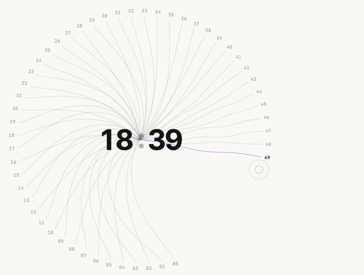
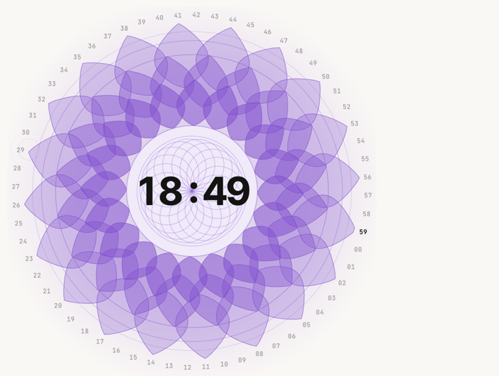
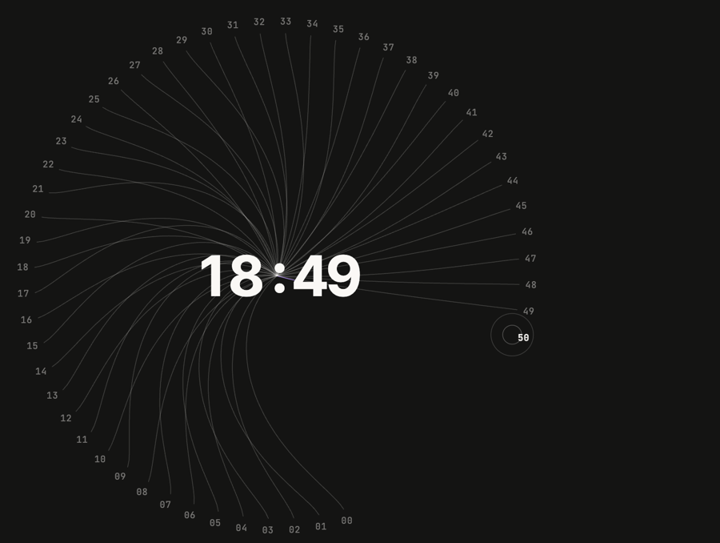

# lotus-clock

A kinetic clock as a drop-in web component. Each second a straight line grows from the time to its place on the dial; every step of the dial leaves a little twist behind, so the lines slowly curl and cross as the minute goes on. In the last seconds the dial makes a full turn and every line folds into a petal of a crown lotus (three rings of 20 around a glowing disc); a ripple of light runs through the digits as the minute changes and the lotus closes back into the centre.

No dependencies, no build step, one file. Works in plain HTML, React, Vue, Svelte or anything else that renders DOM.

**[Live demo →](https://sagunnn.github.io/lotus-clock/)**

<p align="center">
  
  
  
</p>

## Features

- **Stepping dial.** The newest second always lands on the same spot; older seconds travel round.
- **Lines that take shape from motion.** Straight on arrival, curving as the dial turns, tangling in the final spin.
- **Minute finale, choreographed like a watch complication.** From :55 the lotus *inhales*: each tick draws it a little inward and warms its colour. From :56 the dial turns once while each line folds into its own amethyst petal (three rings of 20, offset like scales) around a disc with a turning rosette and a soft violet glow. At :00 it *blooms*: every petal springs outward and dissolves, staggered round the flower, as the bowl is struck.
- **Countdown mode.** Turn it into a focus timer with `countdown('25:00')`, with pause, resume and a `complete` event.
- **Singing bowl.** A physically-inspired Tibetan bowl synthesised with the Web Audio API: inharmonic partials in beating pairs, a soft mallet attack and tiered decays. Press the middle to strike it: a shockwave runs out across the petal rings and the hub trembles.
- **An "Om" drone and a sung chant (with `sound`).** While sound is on, a continuous 136.1 Hz sine (the "Om" tone) plays with a quiet 528 Hz layer, and a formant-synthesised voice sings *OM · MA · NI · PAD · ME · HUM* over it in its own slow rhythm (a 7.4 s cycle; OM and HUM land on the drone's 136.1 Hz). Everything fades in and out gently, and several clocks on one page share one drone and one voice.
- **Rim rubbing (easter egg).** Circle the centre with your cursor or finger and the bowl starts to sing: a sustained drone whose volume and brightness follow how fast you circle, while the lines and hub vibrate, small ripples leave the rim, and phones give a light buzz.
- **Any time zone.** Pass an IANA zone like `Asia/Kathmandu`.
- **Themeable.** Colours and fonts through CSS custom properties; follows `currentColor` by default.
- **Respectful.** Honours `prefers-reduced-motion`, pauses when off-screen or in a background tab, and never plays sound until a user interacts.

## Install

**From a CDN** (no install):

```html
<script type="module" src="https://cdn.jsdelivr.net/gh/Sagunnn/lotus-clock@1.4.0/lotus-clock.js"></script>
```

**With npm** (straight from GitHub):

```sh
npm install github:Sagunnn/lotus-clock
```

```js
import 'lotus-clock';                    // registers <lotus-clock>
// or: import { LotusClock } from 'lotus-clock';
```

**Or copy** [`lotus-clock.js`](lotus-clock.js) into your project and load it with `<script type="module">`.

## Quick start

```html
<script type="module" src="https://cdn.jsdelivr.net/gh/Sagunnn/lotus-clock@1.4.0/lotus-clock.js"></script>

<lotus-clock style="width: 480px"></lotus-clock>
```

The clock is square by default and fills the width you give it (minimum 200px). Set `width`, `height`, or both.

```html
<!-- Kathmandu time, 12-hour, with sound -->
<lotus-clock time-zone="Asia/Kathmandu" hour12 sound></lotus-clock>

<!-- A 25-minute focus timer that starts on load -->
<lotus-clock countdown="25:00" autostart sound></lotus-clock>
```

## Attributes

| Attribute | Default | Description |
| --- | --- | --- |
| `time-zone` | local time | Any IANA time zone, e.g. `Europe/London`, `Asia/Tokyo`. |
| `hour12` | off | Show a 12-hour clock. |
| `labels` | `on` | `off` hides the seconds numbers round the dial. |
| `finale` | `on` | `off` turns off the end-of-minute spin, lotus and glow. |
| `sound` | off | Turns on the *ambient* sound: the 136.1 Hz drone and the sung chant, the swell into the minute, the :00 strike and the countdown bells. Pressing the middle and rubbing the rim always sound, because they are deliberate. Audio starts after the first click, tap or key press (browser autoplay rules). |
| `interactive` | `true` | `false` hides the press-the-middle bowl button. |
| `countdown` | none | Start in countdown mode with this duration: `"25:00"`, `"1:30:00"` or seconds (`"90"`). |
| `autostart` | off | With `countdown`, start counting immediately. |

## JavaScript API

```js
const clock = document.querySelector('lotus-clock');

clock.countdown('25:00');                 // switch to countdown and start
clock.countdown(5 * 60_000, { autostart: false });   // ms also works
clock.pause();
clock.resume();                           // same as start()
clock.toggle();
clock.reset();                            // back to the full duration, paused
clock.showClock();                        // back to the time of day
clock.ring();                             // strike the bowl (sound, shockwave, tremor, glow)

clock.mode;        // 'clock' | 'countdown'
clock.running;     // true while a countdown runs
clock.remaining;   // ms left in the countdown
```

Every method except the getters returns the element, so calls can be chained.

## Events

All events bubble and cross shadow boundaries. `event.detail.mode` is always set.

| Event | When | `detail` |
| --- | --- | --- |
| `second` | Each new second (or countdown second) | `{ value: { a, b, slot, key }, syllable }`, where `syllable` names the second in the cycle *Om · Ma · Ni · Pad · Me · Hum* (`slot % 6`), handy for visuals |
| `minute` | When the minute changes | `{ value }` |
| `complete` | A countdown reaches 00:00 | — |
| `start`, `pause` | Countdown started / paused | — |
| `bowl` | The bowl was rung | — |
| `syllable` | A chant syllable starts (only while `sound` is on) | `{ syllable, hz, vowel, duration }`, e.g. `{ syllable: 'OM', hz: 136.1, vowel: 'Ooo', duration: 1800 }` |
| `rubstart` | Someone started "rubbing the rim" (circling the centre steadily) | `{ speed }` (rad/s) |
| `rubend` | They stopped and the drone faded | — |

`value.a` and `value.b` are the two numbers on screen (hours and minutes, or minutes and seconds in countdown mode).

## Styling

Theme it with CSS custom properties on the element (or any ancestor):

```css
lotus-clock {
  --lc-ink: #141413;           /* digits, labels (default: currentColor) */
  --lc-line: rgba(0,0,0,.2);   /* the lines (default: ink at 20%) */
  --lc-accent: #8a4fd6;        /* newest line, rings, lotus, glow (amethyst) */
  --lc-glow: rgba(138,79,214,.35);
  --lc-paper: transparent;     /* background */
  --lc-paper-solid: #faf8f5;   /* disc behind the time in the finale (default: page background) */
  --lc-font-display: "Inter Tight", Helvetica, Arial, sans-serif;  /* digits */
  --lc-font-weight: 700;
  --lc-font-mono: "JetBrains Mono", ui-monospace, monospace;       /* labels */
}
```

For deeper changes, the shadow DOM exposes parts: `::part(stage)`, `::part(time)`, `::part(bowl)` and `::part(petal)` (every line / petal).

Each petal carries two custom properties you can use in your own animations: `--ring-index` (0 inner, 1 middle, 2 outer) and `--petal-index` (0–19 round its ring). The built-in shockwave staggers by `calc(var(--ring-index) * 65ms)` and the bloom by `calc(var(--petal-index) * 8ms)`.

```css
/* e.g. bolder lines */
lotus-clock::part(petal) { stroke-width: 1.2px; }
```

**Dark mode** is a matter of changing `--lc-ink` (or `color`) and the accent:

```css
@media (prefers-color-scheme: dark) {
  lotus-clock { --lc-ink: #faf8f5; --lc-accent: #b98cff; }
}
```

## Recipes

### A Pomodoro timer

```html
<lotus-clock id="pomodoro" sound></lotus-clock>
<button id="go">Start focus</button>

<script type="module">
  import 'https://cdn.jsdelivr.net/gh/Sagunnn/lotus-clock@1.4.0/lotus-clock.js';

  const clock = document.getElementById('pomodoro');
  const plan = ['25:00', '5:00', '25:00', '5:00', '25:00', '5:00', '25:00', '15:00'];
  let step = 0;

  document.getElementById('go').onclick = () => clock.countdown(plan[step]);
  clock.addEventListener('complete', () => {
    step = (step + 1) % plan.length;
    setTimeout(() => clock.countdown(plan[step], { autostart: false }), 4000);
  });
</script>
```

### React

React 19 supports custom elements directly:

```jsx
import 'lotus-clock';

export function Clock() {
  return <lotus-clock time-zone="Asia/Kathmandu" sound style={{ width: 420 }} />;
}
```

To call methods (any React version), use a ref:

```jsx
import { useRef } from 'react';
import 'lotus-clock';

export function FocusTimer() {
  const ref = useRef(null);
  return (
    <>
      <lotus-clock ref={ref} style={{ width: 420 }} />
      <button onClick={() => ref.current.countdown('25:00')}>Focus</button>
    </>
  );
}
```

In TypeScript, declare the element once:

```ts
declare namespace JSX {
  interface IntrinsicElements {
    'lotus-clock': React.DetailedHTMLProps<React.HTMLAttributes<HTMLElement>, HTMLElement> & Record<string, unknown>;
  }
}
```

### Vue

Tell Vue that `lotus-clock` is a custom element:

```js
// vite.config.js
vue({ template: { compilerOptions: { isCustomElement: (tag) => tag === 'lotus-clock' } } })
```

```vue
<script setup>
import 'lotus-clock';
</script>

<template>
  <lotus-clock time-zone="Europe/London" style="width: 400px" />
</template>
```

### Svelte

```svelte
<script>
  import 'lotus-clock';
</script>

<lotus-clock time-zone="America/New_York" sound style="width: 400px"></lotus-clock>
```

### Server-side rendering

The file only touches the browser when it is imported, so import it on the client (for example inside `useEffect`, `onMount`, or a `"use client"` component).

## Accessibility

- The time is exposed with `role="timer"` and an `aria-label` that stays current (it isn't announced on every change); the lines, numbers and lotus are hidden from screen readers.
- The bowl is a real `<button>` (keyboard focusable, labelled "Ring the singing bowl"). Hide it with `interactive="false"`.
- Rim rubbing is a bonus, not a requirement: every feature is reachable without it. Listen for `rubstart` if you want to tell people they found it (the demo updates its `aria-live` helper text).
- With `prefers-reduced-motion: reduce`, the clock stops animating: lines appear in place and the finale is skipped.
- Ambient sound is off unless you add the `sound` attribute, and even then waits for a user interaction. Pressing the middle or rubbing the rim makes sound because the person chose to.

## Browser support

Current Chrome, Edge, Safari and Firefox. It uses Custom Elements, Shadow DOM, `ResizeObserver`, CSS `color-mix()` and CSS masks.

## How it works

- 60 points sit on a circle. Each second, a line grows from the centre of the time to the newest point, and the whole dial eases one step (6°) counterclockwise so the newest point is always in the same place.
- Every frame, each line rotates its inner points by a lag that grows with how far the dial has turned since the line arrived, plus a little extra while the dial is moving. Neighbouring lines lag by different amounts, so their curves cross.
- From :55 a tick-stepped "inhale" scales every line toward the centre (to 0.95) and raises `--_inhale`, which mixes the accent into the strokes and deepens the fills.
- From :56 the dial adds one full turn and every line eases into a closed petal outline aimed at its own second: line `s` joins ring `s % 3`, so the 60 lines make three rings of 20 petals, and each line's own path is filled, so the petals are the lines. A disc with an 18-circle rosette and a radial glow fade in at the centre, and rings close in on the digits.
- At :00 every petal gets a CSS `bloom` animation: `scale(0.95)` → `scale(1.16)` and fade, with `cubic-bezier(0.22, 1, 0.36, 1)` and `calc(var(--petal-index) * 8ms)` delays, plus the ring-staggered shockwave. A masked copy of the digits reveals a ripple of light, and the hub trembles (a decaying 2.5 px micro-tremor over 1.5 s).
- **The bowl.** Each strike spawns three modal partials at ×1.0 (216 Hz), ×2.756 and ×5.404. Each partial is a *pair* of sines, the second detuned by +1.4, +2.8 and +4.2 Hz, so their phases drift in and out: the bowl's natural pulsing, with no LFO. A 15 ms linear attack avoids clicks; decays are tiered at 9 s, 5.5 s and 2.2 s; 25 ms of low-passed noise adds the wooden mallet's contact. Every node disconnects itself when it finishes, so overlapping strikes layer cleanly. Everything runs through a low-pass filter, a generated room reverb and a faint echo.
- **The drone.** Two pure sines, 136.1 Hz and 528 Hz (the latter at 5% of the former), go straight to the output at a level of 0.12, under the bowl strikes. Change `OM_LEVEL` in the source for more or less presence. A small reference count keeps a single drone running while any clock on the page has `sound` on.
- **The chant.** Each syllable is a sawtooth at its pitch (136.1, 144, 162, 180, 216, 136.1 Hz) with a 5.5 Hz, ±1.5 Hz vibrato, run through two parallel band-pass formant filters for its vowel (Ooo 400/800 Hz, Aaa 700/1200, Eee 300/2200, Mmm 250/500, Q 8–15) and a 0.2 s breathing envelope. Syllables are scheduled about a second ahead on the audio clock, so the rhythm stays steady even when the tab's timers lag. `CHANT_GAIN` sets its level.
- **Rim rubbing.** Pointer movement around the hub is turned into an angle with `Math.atan2`, and its smoothed rate of change into angular velocity. A steady circle above ~2 rad/s swells a sustained drone (the ×1.0 and ×2.756 beating pairs) whose gain, upper-partial level and filter brightness follow your speed; when you stop it decays naturally, and its oscillators are torn down after a few quiet seconds.

## Development

No build step. Serve the folder and open the demo:

```sh
python3 -m http.server 8000
# open http://localhost:8000
```

## License

[MIT](LICENSE) © Sagun Pradhan
